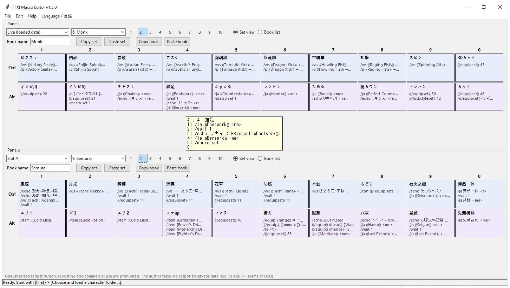
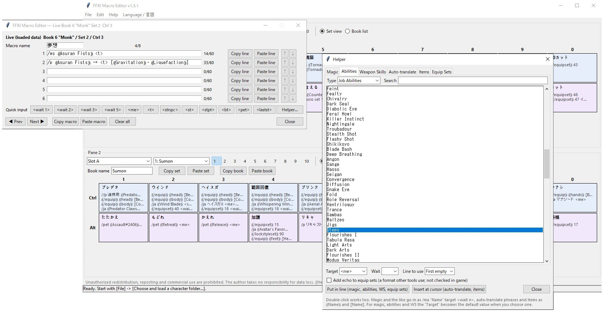
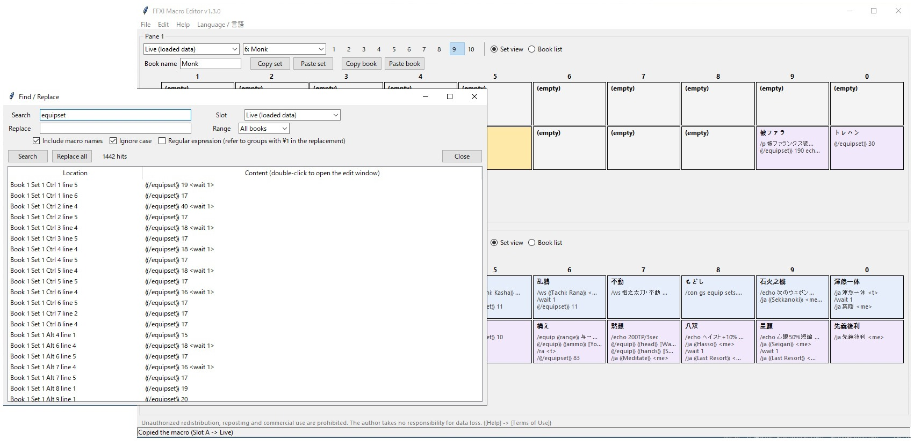

# FFXI Macro Editor (MacroEditor)

[日本語 README](README.md)

A Windows tool for editing FFXI macros on your PC without starting the game.
It handles both the macros in a character's folder and the "file slots" (A-D) on the character selection screen.

**Download from [Releases](../../releases).** Extract the zip and run `MacroEditor.exe` in the folder it creates (no installation; the folder holds several files, so keep them together). The tool is distributed in a form that does not unpack itself into a temporary folder at run time. The SHA256 of the zip is written on the Releases page. The display language can be switched between Japanese and English from the menu ([Language / 言語]); it starts in Japanese if Windows is set to Japanese, and in English otherwise.

> This repository contains only the description and the terms of use for the distributed files. The source code is not published.

## Please read first

- Read the [Terms of Use](TERMS.en.md) before using the tool. They are also shown on the first launch. Use the tool only if you agree.
- **Unauthorized redistribution, copying, reposting, claiming the tool as your own work and commercial use are strictly prohibited.**
- This tool is not officially approved. **Rewriting game files may carry a risk of usage restrictions and the like.** Use it at your own risk, only after you understand and accept this risk.
- The author takes no responsibility for loss or corruption of data. Before you overwrite any game file, always make your own backup as well.
- On the first launch, Windows SmartScreen may show a warning, because the tool is not code-signed and has little download history. If your antivirus reacts, check the SHA256 of the zip written on the Releases page, or do not use the tool.
- **About the English client:** this tool has been checked in game with Japanese-client files only. Macro files from the English client are expected to use the same layout, but this has not been checked. Please back up first and try it on a slot you can afford to lose. If something does not work, please open an issue.

## What it can do

- Load and edit the macros in a character's folder (40 books x 10 sets x 10 Ctrl + 10 Alt macros)
- Load and edit the macros inside the **file slots (A-D) on the character selection screen**, and export them as slot files
- Show different slots in the two panes (top and bottom) and copy macros by dragging (Shift to swap). Copy and paste by macro, set and book
- Open another character's folder and copy from it. Edit two characters at the same time
- Views: set view (20 macros with their contents), book list, and edit windows (as many as you like at once)
- Show and type auto-translate phrases and item names by name (when Windower is installed)
- Helper: choose spells, abilities, weapon skills, auto-translate phrases, items and equipment sets from a list (filter by job, type, weapon type)
- Find / Replace (Ctrl+F), export to / import from text, Undo (Ctrl+Z)
- The original files are backed up automatically every time you load files for editing
- Display language switching between Japanese and English ([Language / 言語] in the menu; the tool closes when you switch, and the change applies after you restart it)

## How to use

### Macros in a character folder

1. [File] -> [Choose and load a character folder...], choose the character folder and press [Load into Live]
2. Click a macro to edit it
3. [File] -> [Export...] writes the changed files to the `output` folder
4. **After closing the game completely**, copy the exported files over the character's folder yourself

### The file slots (A-D) on the character selection screen

1. [File] -> [Load game slots (A-D)...], choose a slot and press [Load] (pane 1 switches to that slot)
2. Edit in pane 1
3. [File] -> [Export...], choose that slot, choose the slot (A-D) to write to, and export
4. **After closing the game completely**, copy the exported `FFXI0.DAT` - `FFXI3.DAT` over
   `PlayOnline\SquareEnix\PlayOnlineViewer\pub\home??\open\ContentsData\FinalFantasyXI\` yourself
5. Load that slot with [Load] on the character selection screen

First try it on a slot you can afford to lose, changing just one macro. Only the macros change; the other settings inside the slot are kept as they were when loaded.

This tool does not write into the game's folder. Overwriting is always done by you yourself. It does not need to be run as administrator, as long as you do not put it in a folder such as `Program Files` that needs administrator rights to write to. Settings, exports and backups are created next to the EXE.

## Requirements

- Windows 10 / 11
- To see auto-translate phrases and item names by name, Windower's `res` folder is needed. If you put the extracted folder in `windower\addons\` (so that you get `windower\addons\MacroEditor\MacroEditor.exe`) it is found automatically. Otherwise choose it with [File] -> [Specify the Windower res folder...]

## Credit

Built with reference to the ideas of the FF11 macro editing tool by "FF11 Tarutaru 3 Sisters" (FF11タルタル3姉妹).

---

"FINAL FANTASY" and "PlayOnline" are trademarks or registered trademarks of Square Enix Co., Ltd. This tool has no relation whatsoever to Square Enix Co., Ltd.

Author: hikaruoshino
