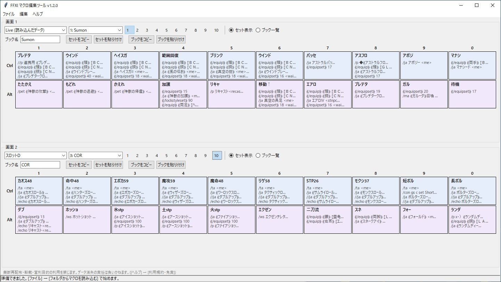
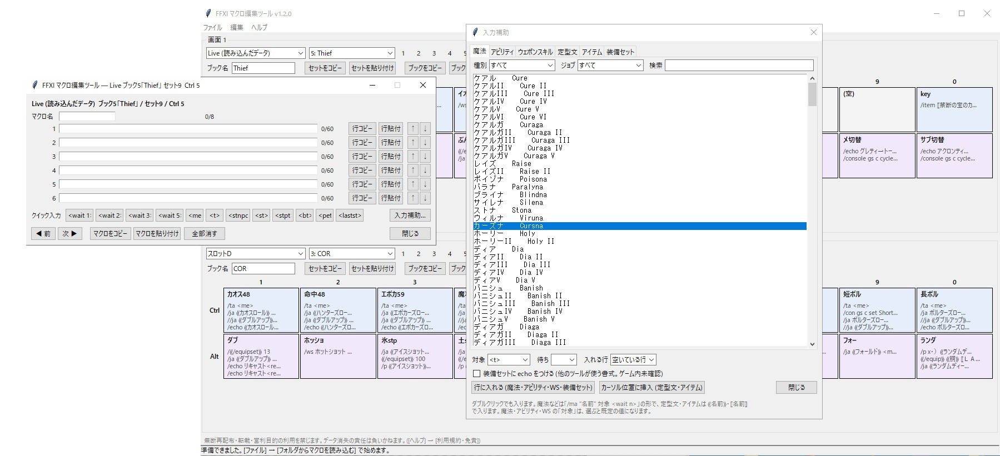
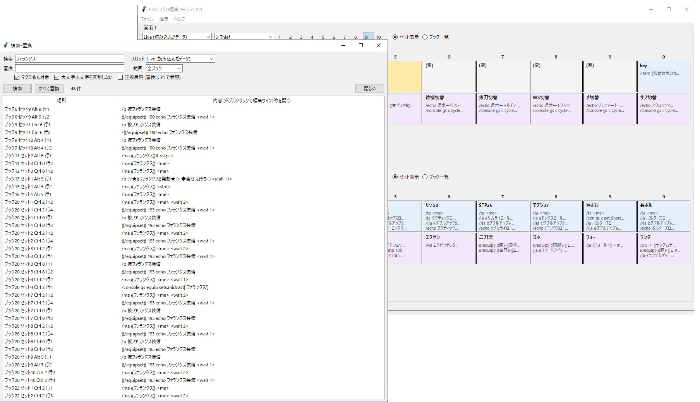

# FFXI マクロ編集ツール (MacroEditor)

[English README](README.en.md)

ゲームを起動せずに、PC で FF11 のマクロを編集する Windows 用のツールです。
キャラクターのフォルダのマクロと、キャラクター選択画面の「ファイルスロット」(A〜D) の両方を扱えます。

**ダウンロードは [Releases](../../releases) から。** zip を展開して、できたフォルダの中の `MacroEditor.exe` を起動します (インストール不要。複数のファイルが入っているので、フォルダごと使ってください)。実行時にファイルを一時フォルダへ展開しない形式で配布しています。zip の SHA256 は Releases に書いています。

> このリポジトリには、配布物の説明と利用規約だけを置いています。ソースコードは公開していません。

## 必ずお読みください

- 使う前に、[利用規約](TERMS.md) を必ず読んでください。最初の起動時にも表示されます。同意した方だけお使いください。
- **無断再配布、複製、転載、自作発言 (他者による自作主張)、および営利目的での利用を固く禁じます。**
- このツールは公式に認められたものではありません。**ゲームのファイルを書き換えることには、利用制限などを受けるリスクがあり得ます。** リスクを理解し、納得したうえで、すべて自己責任でお使いください。
- データの消失・破損などについて、作者は責任を負いかねます。ゲームのファイルを上書きする前に、必ずご自身でもバックアップを取ってください。
- 初めて起動したとき、Windows の SmartScreen が警告を出すことがあります (署名をしておらず、配布の実績が少ないため)。ウイルス対策ソフトが反応したときは、Releases に書いている zip の SHA256 を確かめるか、使用を控えてください。

## できること

- キャラクターのフォルダのマクロ (40 ブック × 10 セット × Ctrl/Alt 各 10 個) を読み込んで編集
- キャラクター選択画面のファイルスロット (A〜D) の中のマクロを読み込んで編集し、スロット用のファイルとして出力
- 上下 2 つの画面に別々のスロットを並べて、マクロをドラッグでコピー (Shift で入れ替え)。マクロ・セット・ブックの単位でコピー&貼り付け
- 別のキャラのフォルダを開いて、そこからコピー。2 人分を同時に編集
- 表示: セット表示 (20 個を中身つきで一覧)・ブック一覧・編集ウィンドウ (いくつでも同時に開ける)
- 定型文・アイテム名を名前で表示・入力 (Windower を使っている場合。表示言語に合わせて日本語か英語の名前になります)
- 入力補助: 魔法・アビリティ・ウェポンスキル・定型文・アイテム・装備セットを一覧から選んで入力 (ジョブ・種別・武器種で絞り込み)
- 検索・置換 (Ctrl+F)、テキストへの書き出し・取り込み、元に戻す (Ctrl+Z)
- 編集用に読み込むたびに、元のファイルを自動でバックアップ
- 表示言語を日本語 / English で切り替え (メニューの [Language / 言語]。切り替えると一度終了し、起動し直すと反映されます。Windows の表示言語が日本語なら日本語、それ以外は英語で起動します)

## 使い方

### キャラクターのフォルダのマクロ

1. [ファイル] → [キャラのフォルダを選んで読み込む] で、キャラクターのフォルダを選んで [Live に読み込む]
2. マクロをクリックして編集
3. [ファイル] → [出力] で、変更したファイルを `output` フォルダに書き出す
4. **ゲームを完全に終了してから**、出力されたファイルをキャラクターのフォルダに自分で上書きコピー

### キャラクター選択画面のファイルスロット (A〜D)

1. [ファイル] → [ゲームのスロット (A〜D) を読み込む] で、スロットを選んで [読み込む] (画面 1 が、そのスロットに切り替わります)
2. 画面 1 で編集
3. [ファイル] → [出力] で、そのスロットを選び、書き出す先のスロット (A〜D) を選んで出力
4. **ゲームを完全に終了してから**、出力された `FFXI0.DAT`〜`FFXI3.DAT` を
   `PlayOnline\SquareEnix\PlayOnlineViewer\pub\home??\open\ContentsData\FinalFantasyXI\` に自分で上書きコピー
5. キャラクター選択画面の [読み出し] で、そのスロットを読み出す

最初は、捨ててもよいスロットで、マクロを 1 つだけ変えて試してください。変わるのはマクロだけで、スロットの中のほかの設定は読み込んだときのまま保ちます。

このツールは、ゲームのフォルダには書き込みません。上書きは必ず利用者自身の手で行います。管理者権限での起動は不要です (ただし、`Program Files` など書き込みに管理者権限が要るフォルダには置かないでください。設定・出力・バックアップは EXE と同じ場所に作ります)。

## 動かす環境

- Windows 10 / 11
- 定型文・アイテム名を日本語で見るには、Windower の `res` フォルダが必要です。展開したフォルダを `windower\addons\` に置く (`windower\addons\MacroEditor\MacroEditor.exe` になるようにする) と自動で見つかります。別の場所のときは [ファイル] → [Windower の res フォルダを指定] で選んでください

## 謝辞

FF11タルタル3姉妹のFF11マクロ編集ツールのアイデアを参考に作成しました。

---

「ファイナルファンタジー」「FINAL FANTASY」「PlayOnline」は、株式会社スクウェア・エニックスの商標または登録商標です。このツールは、株式会社スクウェア・エニックスとは一切関係がありません。

作者: hikaruoshino

## 不具合・動作報告 / Feedback

「動きました」の一言だけでも歓迎です。GitHub のアカウントがあれば、[Issues](../../issues/new/choose) から書き込めます (日本語・英語どちらでも)。

A one-line "it works" is welcome too. With a GitHub account you can post from [Issues](../../issues/new/choose) (Japanese or English).
